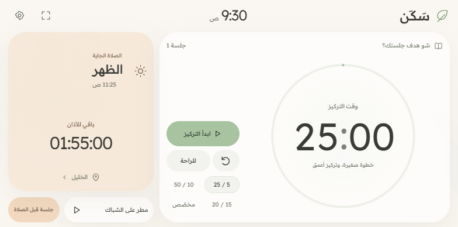

# سَكَن · Sakin

غرفة دراسة صغيرة على أندرويد: مؤقّت تركيز، الصلاة الجاية مع عدّ تنازلي، وأصوات هادئة — بدون حساب أو إنترنت.

**Native Android APK · Java + local WebView · Arabic RTL · Offline**

[تحميل التطبيق من الإصدارات](https://github.com/hasanazir1/study_with_me/releases/latest) · [التقدّم الحالي](docs/PROGRESS.md) · [الخطة](docs/ROADMAP.md) · [تعليمات التطوير](docs/DEVELOPMENT.md)



*معاينة لنفس ملفات الواجهة، بمواقيت توضيحية. ليست صورة من جهاز أندرويد فعلي.*

## وين وصلنا؟

أحدث نسخة **1.2.1 / versionCode 4 — المرحلة الثانية**: أصوات ستيريو جديدة بمزيج طبقات، محرك AudioTrack أصلي، انتقالات صوت ناعمة، مؤقّت نوم، ونغمة عند انتهاء التركيز والراحة. تبدأ الراحة تلقائيًا بعد خمس ثوانٍ مع إمكانية الإلغاء؛ الدراسة التالية تبدأ بإيدك.

تحسنت حركة الأرقام والصفحات وخفّ عبء التمويه، وتعمل الأزرار من أول ضغطة بعد خفوتها. الواجهة السابقة والصلاة والمدينة والسجل محفوظة.

**المرحلة الثانية جاهزة للبناء والتجربة، وبانتظار ملاحظات الجوال. المشاهد والشخصية لم تبدآ.** [تجربة النسخة](docs/PHASE2_TEST_AR.md) · [مصادر الصوت والمحرك](docs/AUDIO.md).

الريبو يحفظ نسختين سابقتين كنقطتي بداية، ثم تجهيزات Git والتوثيق والفحوص. التاريخ الأولي مستورد من نسخ محفوظة؛ ليس سجلًا لكل تعديل قديم على حدة. من الآن نسجّل التعديلات بcommits صغيرة وواضحة.

## ماذا يعمل الآن؟

- مؤقّت دراسة واستراحة: 25/5، 50/10، 20/15 أو مدد مخصّصة، مع إيقاف واستكمال وإعادة ضبط.
- الصلاة القادمة وموعدها والمتبقي، اختيار المدينة، طريقة الحساب والمذهب، وتعديل الدقائق.
- مواقيت اليوم وعلامة «صليت»، وزر «جلسة قبل الصلاة».
- أربعة أجواء صوت مختلفة وخيار هدوء، بطبقتين لكل جو، وتحكم بالحجم العام والطبقات ومؤقّت لإيقاف الصوت. تشغيل أصلي بالخلفية مع MediaSession.
- إعدادات محلية، هدف للجلسة وسجل تركيز يومي، وحركات أخف وخيارات اهتزاز.

المؤقّت والصلاة والمزج الصوتي لها اختبارات، وتم فحص الأصول وبناء APK والتحقق من توقيعه. جرّب المستخدم المرحلة الأولى وأبلغ عن الصوت والحركة وتسلسل الراحة؛ **الإصدار الجديد لم يُجرّب هنا على جهاز أندرويد أو محاكي**. فحص المتصفح يختبر الواجهة بجسر تجريبي فقط؛ راجع [التقدّم](docs/PROGRESS.md) و[قائمة تجربة النسخة](docs/PHASE2_TEST_AR.md).

## ابدأ بالكود

```text
git clone https://github.com/hasanazir1/study_with_me.git
cd study_with_me
```

هذا مشروع **Java Activity + WebView عادي**، وليس Capacitor أو Cordova أو تطبيق ويب مستضاف. لا يوجد PWA أو service worker. كل الخطوط والأصوات وحساب الصلاة محلي داخل APK، ولا توجد صلاحية إنترنت.

```text
AndroidManifest.xml       الحزمة وإصدار أندرويد والصلاحيات
src/com/sakin/study/      المؤقّت والصلاة والخدمات والجسر الأصلي
assets/                  الواجهة العربية والخط والأصوات
res/                     هوية التطبيق وموارد أندرويد
libs/                    مكتبة الصلاة المرخّصة
tests/                   اختبارات المؤقّت والصلاة والواجهة
tools/                   تجهيز الأصوات وأدوات التطوير
docs/                    التقدم والخطة والتطوير والبنية
build.py                 بناء APK بأدوات Android SDK مباشرة
AGENTS.md                تعليمات أي شخص أو AI يكمل المشروع
```

## الاختبارات

تحتاج Python 3.10+ وJDK 17+، وNode.js لفحص JavaScript. لا تحتاج مفتاح التوقيع أو Android SDK لتشغيل هذه الفحوص:

```text
python tests/run_tests.py
python tests/check_ui.py
python tests/check_audio.py
node --check assets/app.js
```

تعمل الفحوص تلقائيًا عبر [GitHub Actions](https://github.com/hasanazir1/study_with_me/actions) عند الدفع إلى `main` أو فتح pull request. لا تحمل هذه الفحوص مفتاح توقيع ولا تنشر APK تلقائيًا.

## بناء APK

يلزم JDK 17+ وAndroid SDK Platform 35 وBuild Tools 35.0.0، مع **مفتاح التوقيع الأصلي** للإصدارات الرسمية:

```text
python build.py --sdk /path/to/android-sdk --java /path/to/jdk --keystore /private/path/to/sakin-local.p12 --out build/sakin-study.apk
```

يمكن استخدام `JAVA_HOME` و`ANDROID_SDK_ROOT`/`ANDROID_HOME` و`SAKIN_KEYSTORE` بدل المسارات. البناء مباشر عبر AAPT2 وjavac وD8 وzipalign وapksigner؛ لا يوجد إعداد Gradle حاليًا. [خطوات البناء وGit كاملة](docs/DEVELOPMENT.md).

الحزمة الرسمية `com.sakin.study`. **مفتاح التوقيع يبقى خارج Git**؛ البناء يتوقف عند غيابه ولا ينشئ بديلًا قد يمنع تحديث التطبيق. يمكن لأصحابك أو AI قراءة المشروع وتعديله وتشغيل اختباراته دون هذا المفتاح. ملفات APK الجاهزة موجودة في Releases.

## المشاركة والمتابعة

اقرأ [AGENTS.md](AGENTS.md) ثم [PROGRESS](docs/PROGRESS.md) و[ROADMAP](docs/ROADMAP.md). للتعديلات الجديدة نستعمل فرعًا واضحًا، وفحوصًا مناسبة، وcommit يصف النتيجة، ثم نحدّث سجل التقدم ونحفظه على GitHub. نتوقف بعد كل مرحلة للملاحظات.

- [CHANGELOG](CHANGELOG.md): ماذا تغيّر في كل نسخة؟
- [ARCHITECTURE](docs/ARCHITECTURE.md): كيف تتصل الواجهة بأندرويد؟
- [CONTRIBUTING](CONTRIBUTING.md): كيف تساهم؟
- [THIRD_PARTY](docs/THIRD_PARTY.md): المكتبات والخطوط والتراخيص الموجودة.

ترخيص عام للكود الأصلي لم يُختَر بعد؛ تراخيص مكتبة Adhan وخط Readex موجودة مع ملفاتهما.
